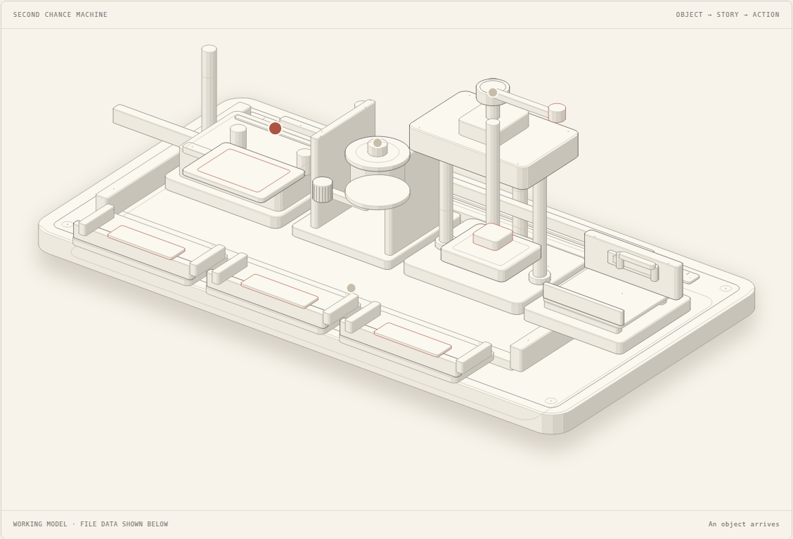

# Tokyo Afterlife Bureau

**A little forgotten. A lot of soul.**

A mobile-first web experience that turns a forgotten object and a personal memory into an original spirit, a fictional story, and a practical second-life plan. Inspired by Japanese object-spirit folklore, creatively set in Tokyo.

## Try it

**[Open the public mobile demo](https://liyue2055.github.io/tokyo-afterlife-bureau/)** · **[Go straight to the Spirit Workshop](https://liyue2055.github.io/tokyo-afterlife-bureau/?view=demo#spirit-workshop)**

GitHub Pages runs the sample experience entirely in the browser: photo intake, authored stories, case saving, promises, card export, workshop animation, and device narration. It makes no AI request and contains no provider keys. The private server-hosted version supports live AI generation and the separate media presentation.

The private hosted demo includes a Demo room with a narrated 34-second film, captions, an AI-generated umbrella animation, and an instrumental score. A four-scene interactive presentation and authored sample cases work without an AI key.

For judging: open **Demo room**, play the short film, then explore **Spirit Workshop** and choose a sample or your latest generated case. The workshop labels samples and filed AI cases explicitly; replaying the machine does not make an AI request. Choose an action tray to open its next chapter. You can also choose **Try the sample case**. Open **Next chapter**, choose a promise, and show the saved case in **My case files**. Photo intake and live AI generation are a separate, clearly identified flow.

## Features

- Responsive phone and desktop layouts; camera/photo-library upload with local resizing.
- Three sample spirits plus five object categories.
- Server-side, multimodal OpenRouter case generation with structured-output validation.
- Fictional character name, personality, story and wish; curated category-specific care suggestions.
- Device-local saved cases, promises, filters, removal, and PNG sharing/export.
- Interactive presentation with opt-in device narration and music, keyboard controls, and direct `?view=demo` links.
- An Anatomy-powered Spirit Workshop: an isometric letterpress driven by actual sample or AI case data, with photo/memory/story stages and action trays.
- Folklore context, sources, and transparent AI/sample labels.
- Web-app manifest for home-screen use. The service worker caches static artwork only; this is not a full offline application.

## Local setup

Requires Node.js 22.13+ and npm.

```sh
npm ci
npm run dev
```

Open http://127.0.0.1:5173. No API key is required for sample mode.

For live generation, create an **untracked** `.dev.vars` file:

```text
OPENROUTER_API_KEY="your-key"
AI_MODEL="google/gemini-3.8-flash"
```

Restart the server after changing local secrets. Configure the same values as server-side secrets/environment variables on your hosting provider. Never use `NEXT_PUBLIC_` for API keys. The selected model follows the owner's approved model configuration; choose a model available and authorized on your own provider account.

The private Sites deployment is configured through `.openai/hosting.json`; it preserves the Vinext Sites adapter. That hosting identity belongs to the original deployment. For your own deployment, create a fresh Sites project and replace the identity rather than targeting the existing project.

## Presentation media

Generated audio and video are **not committed or covered by the source license**. They are private demo deliverables, with plan-dependent provider rights. See [media production notes](docs/MEDIA.md), [rights record](docs/MEDIA-RIGHTS.md), [pitch script](docs/pitch-script.txt), and [captions](docs/bureau-trailer.vtt).

To add your own media, create `public/media/` with `bureau-trailer.mp4`, `bureau-trailer.vtt`, `bureau-score.mp3`, `umbrella-awakening.mp4`, `umbrella-poster.jpg`, and a `manifest.json` containing an `assets` array. The app's interactive, silent presentation remains available without these files. The short-film control appears only when its media is available.

## Validation

```sh
npx tsc --noEmit
node --experimental-strip-types --test tests/backend.test.mjs
npm run build
```

The build regenerates workshop geometry using the vendored Anatomy kit. To regenerate just that illustration, run `npm run art:workshop`. Backend tests exercise request origins, methods, missing-key behavior, malformed images, real streamed body limits, and validated mocked provider output. Browser QA covers mobile overflow, sample creation, saving, persistence, promises, presentation navigation, and film playback. Live provider checks are separate from offline tests.

## Architecture and privacy

Vinext/React + TypeScript, Cloudflare Worker API, OpenRouter vision/text, and browser local storage. No app database or photo-storage server. A live request sends the resized photo and memory to OpenRouter and its selected model provider. Saved case data is stored on the current device, is not encrypted by this app, and can be removed through the case list or browser settings. The worker enforces a 1.5 MB input limit and same-origin requests; keep hosted AI use behind the private access boundary unless adding an appropriate public authentication/rate-limit layer.

Spirits and stories are invented; portraits are illustrated archetypes, not personalized generated images. Suggestions are general, not repair instructions. Electrical items need professional assessment. Promises measure user intent, not actual waste reduction.

Source code: MIT. Third-party dependencies retain their own licenses. Generated media has separate provider terms; see the rights record. Historical inspiration: [National Diet Library Gallery](https://ndlsearch.ndl.go.jp/en/gallery).

## Open-source tools



The interactive Spirit Workshop uses a pinned subset of [Anatomy](https://github.com/wheresryan22/anatomy), MIT © 2026 Ryan; its licence and revision are retained in `vendor/anatomy/`. Geometry is precomputed at build time, so the upstream geometry generator does not ship in the browser. The machine is an explanatory metaphor, not a simulation of model internals.

[PPT Master](https://github.com/hugohe3/ppt-master) was evaluated as an external workflow for a future editable PowerPoint, rather than a phone runtime dependency. [Open-source evaluation](docs/OPEN-SOURCE.md) and a [six-slide pitch outline](docs/PITCH-OUTLINE.md) are included. No PowerPoint export is claimed by this version.

## GitHub Pages deployment

`npm run build:pages` creates `dist-pages/` using the same React interface with static-only adapters. Public asset paths use the repository subpath. `npm run preview:pages` serves the production build locally. The Pages workflow builds and deploys on pushes to `main`; repository Pages settings use GitHub Actions. No deployment or model secrets are required in this workflow.

The build copies an explicit artwork/manifest allowlist and creates an empty media manifest. Ignored private audio/video in `public/media/` is excluded. The existing Vinext/Worker build remains available through `npm run build`.
